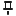

# MDSHO Font

### Used in MDSHO application.

Version: **1.16**

| Icon | Name | Code | Icon | Name | Code |
| :---: | :--- | :--- | :---: | :--- | :--- |
|  | mdsho_s | \&#xe900; |  | mdsho_o | \&#xe901; |
|  | times_s | \&#xe902; |  | times_o | \&#xe903; |
|  | rename_s | \&#xe904; |  | rename_o | \&#xe905; |
|  | settings_s | \&#xe906; |  | settings_o | \&#xe907; |
|  | clone_s | \&#xe908; |  | clone_o | \&#xe909; |
|  | clones_s | \&#xe90a; |  | clones_o | \&#xe90b; |
|  | dock_left_s | \&#xe90c; |  | dock_left_o | \&#xe90d; |
|  | dock_top_s | \&#xe90e; |  | dock_top_o | \&#xe90f; |
|  | dock_right_s | \&#xe910; |  | dock_right_o | \&#xe911; |
|  | dock_bottom_s | \&#xe912; |  | dock_bottom_o | \&#xe913; |
|  | shortcuts_s | \&#xe914; |  | shortcuts_o | \&#xe915; |
|  | shortcut_s | \&#xe916; |  | shortcut_o | \&#xe917; |
|  | minus_s | \&#xe918; |  | minus_o | \&#xe919; |
|  | plus_s | \&#xe91a; |  | plus_o | \&#xe91b; |
|  | delete_s | \&#xe91c; |  | delete_o | \&#xe91d; |
|  | cut_s | \&#xe91e; |  | cut_o | \&#xe91f; |
|  | copy_s | \&#xe920; |  | copy_o | \&#xe921; |
|  | paste_s | \&#xe922; |  | paste_o | \&#xe923; |
|  | asc_s | \&#xe924; |  | asc_o | \&#xe925; |
|  | desc_s | \&#xe926; |  | desc_o | \&#xe927; |
|  | theme_s | \&#xe928; |  | theme_o | \&#xe929; |
|  | info_s | \&#xe92a; |  | info_o | \&#xe92b; |
|  | warning_s | \&#xe92c; |  | warning_o | \&#xe92d; |
|  | desktop_s | \&#xe92e; |  | desktop_o | \&#xe92f; |
|  | control_s | \&#xe930; |  | control_o | \&#xe931; |
|  | brush_s | \&#xe932; |  | brush_o | \&#xe933; |
|  | send_s | \&#xe934; |  | send_o | \&#xe935; |
|  | key_s | \&#xe936; |  | key_o | \&#xe937; |
|  | database_s | \&#xe938; |  | database_o | \&#xe939; |
|  | command_s | \&#xe93a; |  | command_o | \&#xe93b; |
|  | bookmark_s | \&#xe93c; |  | bookmark_o | \&#xe93d; |
|  | share_s | \&#xe93e; |  | share_o | \&#xe93f; |
|  | star_s | \&#xe940; |  | star_o | \&#xe941; |
|  | shield_s | \&#xe942; |  | shield_o | \&#xe943; |
|  | folder_s | \&#xe944; |  | folder_o | \&#xe945; |
|  | globe_s | \&#xe946; |  | globe_o | \&#xe947; |
|  | run_s | \&#xe948; |  | run_o | \&#xe949; |
|  | wizard_s | \&#xe94a; |  | wizard_o | \&#xe94b; |
|  | comment_s | \&#xe94c; |  | comment_o | \&#xe94d; |
|  | note_s | \&#xe94e; |  | note_o | \&#xe94f; |
|  | thumbtackleft_s | \&#xe950; |  | thumbtackleft_o | \&#xe951; |
|  | thumbtackdown_s | \&#xe952; |  | thumbtackdown_o | \&#xe953; |
|  | ok_s | \&#xe954; |  | ok_o | \&#xe955; |

MDSHO Font was created using the free version of <b>[IcoMoon](https://icomoon.io)</b> generator.