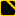
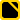
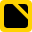
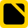
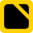
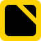
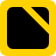
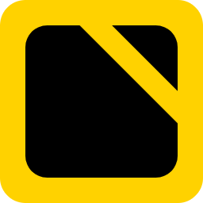
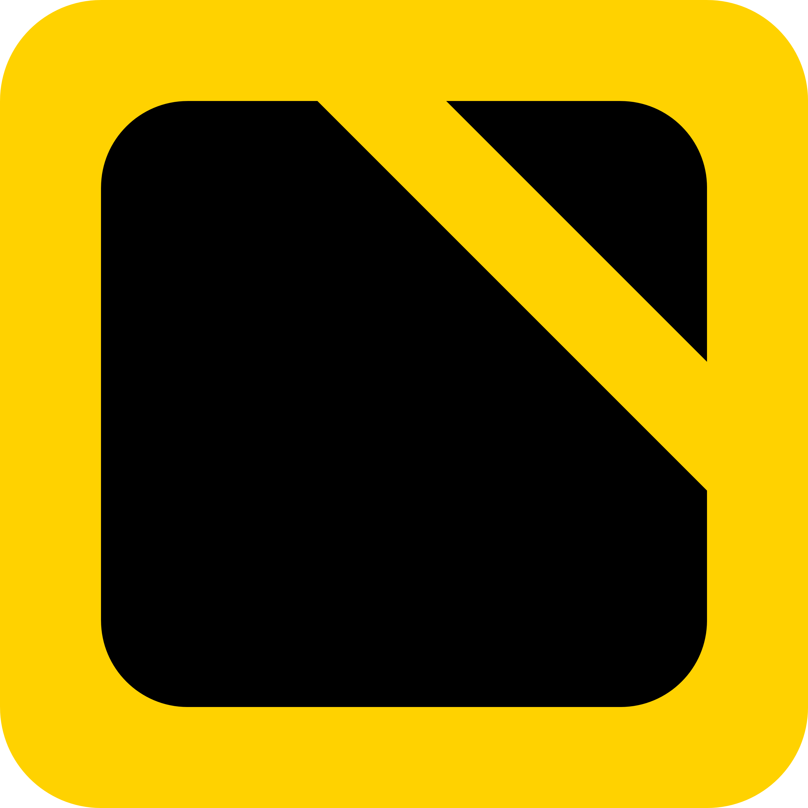

# Logo

|logo | dimensions|
| :---: | :---: |
|  | 16 x 16 |
|  | 20 x 20 |
|  | 24 x 24 |
|  | 28 x 28 |
|  | 32 x 32 |
|  | 36 x 36 |
|  | 40 x 40 |
|  | 44 x 44 |
|  | 48 x 48 |
|  | 52 x 52 |
|  | 56 x 56 |
|  | 60 x 60 |
|  | 64 x 64 |
|  | 72 x 72 |
|  | 80 x 80 |
|  | 88 x 88 |
|  | 96 x 96 |
|  | 104 x 104 |
|  | 112 x 112 |
|  | 120 x 120 |
|  | 128 x 128 |
|  | 256 x 256 |
|  | 3000 x 3000 (source for the Visual Assets generator in the package manifest) |

The vector source is `logo.svg` (256 x 256); the PNG sizes and `logo.ico` are exports of it.
